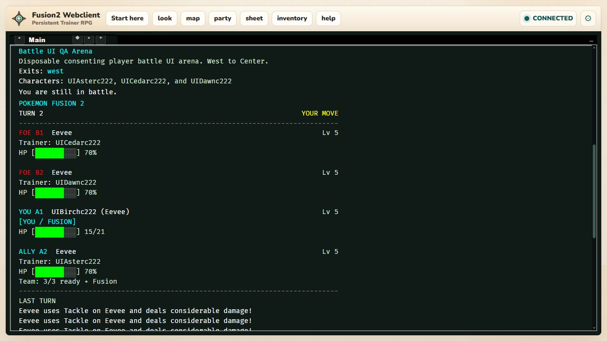

# Local battle UI player acceptance — 2026-10-27

Tested a frozen copy of `195f82494a7c0e973b53ca0f0e6f3244bf7873d8`, then
retested the fixes through final gameplay candidate
`7e78f6859b2f2b2c271f993a349da34cf0597949`. This is real local Telnet and
WebSocket gameplay, including visual inspection of the actual webclient.

## Isolation and prerequisites

No local Evennia instance was running at baseline. A new PostgreSQL 16 cluster
bound only to `127.0.0.1:53410`, a random disposable schema, and a frozen source
archive without `secret_settings.py` supplied the QA world. Its Evennia ports
were 53411–53415. Connection guards checked the host, port, schema and data
directory. Existing PostgreSQL on 5432 was never connected to or restarted.
PF2-Dev, existing characters and existing Pokémon were outside this fixture.

Four accounts completed normal registration and character generation with
ordinary `Player` permissions. One chose a personal Eevee Fusion. Separate,
labelled staff setup installed the private Center/arena, three level-5
known-move Pokémon per player in physical party slots **2, 4 and 6**, finite
PP Up stock, a fixture wallet and one zero-PP move. Original human starters
were boxed through PlacementService; the reserved personal Fusion remained
separate. Those prerequisites do not prove ordinary acquisition or learning.

## Findings fixed

| Trigger | Before | Verified result |
| --- | --- | --- |
| Open a normal owned/Fusion move menu | Unused name-only runtime moves showed `--` PP | Menu and HUD read saved remaining PP and boosted capacity; explicit zero stays `NO PP` |
| Reconnect before choosing an action | Shared waiting hint overrode the player’s unchosen slots | `YOUR MOVE`, or `ACTION QUEUED` when all owned choices are saved |
| Click webclient **party** / **sheet** | Legacy `party` alias opened the trainer sheet; plain `sheet` was unavailable | Buttons send `+party` and `+sheet`; actual browser clicks returned the correct views |
| Resolve Withdraw | One actual Defense increase produced two identical messages for the same user/target | One message per viewer, with the actual stage still `+1` |

Move presentation uses a read-only adapter. It does not mutate PP, effects or
choices, invent a capacity for partial snapshots, or borrow owned PP for
temporary Mimic/Transform moves. The stat-message repair only avoids reporting
the same self-target twice; move resolution and opposing-target messages remain
unchanged.

## Normal routes verified

- Human and personal Fusion onboarding; `+party`, `+sheet` and
  `+party/moves fusion`; reserved Fusion versus ordinary party counts.
- Consenting singles through 13 real turns, natural knockouts, engine reserve
  send-outs and victory. Status/boost badges and reduced team-ready counts
  followed the actual state. No accuracy or damage outcome was forced.
- Two-controller doubles with A1/A2/B1/B2 and the Fusion acting in A1.
  `+switch A2` listed physical slots 4/6; selecting 4 changed only A2.
- Move letters, `? A`/`? D`, cancel, invalid target refusal, a saved-zero move
  refusal followed by a legal choice, and remaining PP after resolution.
- Normal finite-shop purchase, `+use PP Up=2`, then `+use Tackle` produced
  `42/42`; later turns showed `41/42` and `40/42`.
- Legacy, classic_modern and PF1 HUD preferences; screenreader, ASCII and
  Unicode modes; returning to the default compact HUD.
- Ordinary logout/login/`goic 1` recovery via Telnet and WebSocket, with the
  same battle, turn, physical slots and choices still usable.
- Four-controller Multi: all four consented and readied; personal Fusion,
  two complete turns, a browser-submitted Fusion move and wrong-controller
  refusal. Each player saw absolute HP only for their own cell; ally and foe
  cells used percentages. Read-only evidence checks parsed all four cells
  independently for all four viewers.
- Ordinary observer redraw, Fusion participation/order controls, concession,
  cleared battle route, subsequent movement and Center healing.
- A fresh final-build battle resolved Withdraw and retained one stat-change
  line for each viewer, with the displayed stage `+1`.

The bounded [structured receipt](battle-ui-live-2026-10-27.json) records 300
ordinary transport commands and 75 successful explicit text checks. Exploratory
commands without expectations are not counted as assertions. Full redacted
transcripts, separate prerequisite records and read-only snapshots remain in
the task artifact directory outside the repository.

The screenshot uses the webclient’s ordinary expanded output pane. The default
1280×720 split layout requires scrollback to inspect the complete four-player
HUD, turn results and move list.

## Automated qualification and limits

The final focused run passed **47 tests**, including saved-zero/boosted PP,
copied-move PP isolation, reconnect choices, real command parsing/rendering and
single stat announcements. The tightened stat-message assertion failed before
the fix with **2 messages instead of 1**. Final mandatory combined/repeat/
battle-first runs and hosted CI receipts are recorded in the pull request
containing this report; merge requires their completion.

The runner preserved normal account throttling. A virgin-world initial reset
interrupted early registration, which was retried after readiness. An initial
wallet prerequisite was incorrectly saved, so purchase correctly refused; the
labelled wallet was corrected. Initial PP Up input incorrectly used an inline
move selector; the documented two-step prompt passed. One initial expectation
assumed unused Tackle PP after a turn; the actual value was correctly 34. These
are retained runner/expectation corrections, not hidden gameplay failures.

The initial virgin-server handoff logged `AdminPortal2Server` before its first
setup reset completed. Final tested battle commands produced no server
tracebacks. This report does not claim a clean existing-game reload, production
deployment, human-character acceptance, arbitrary roster coverage, or ordinary
acquisition of the staff-installed fixtures. QA-only service/schema cleanup and
final branch synchronization receipts accompany the PR qualification.
