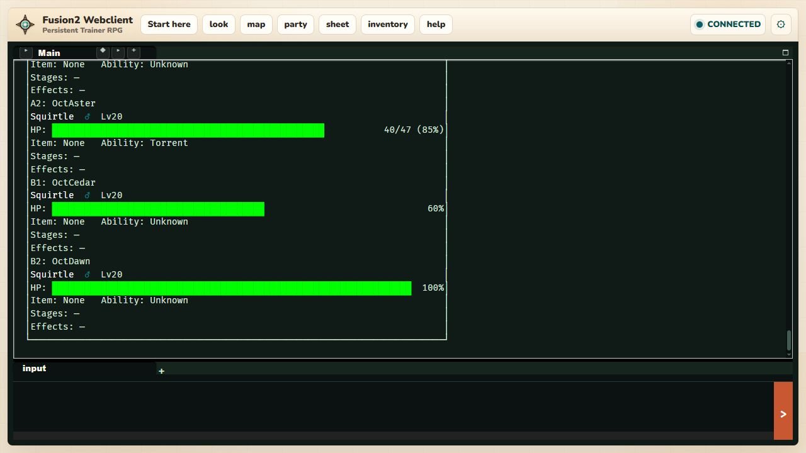
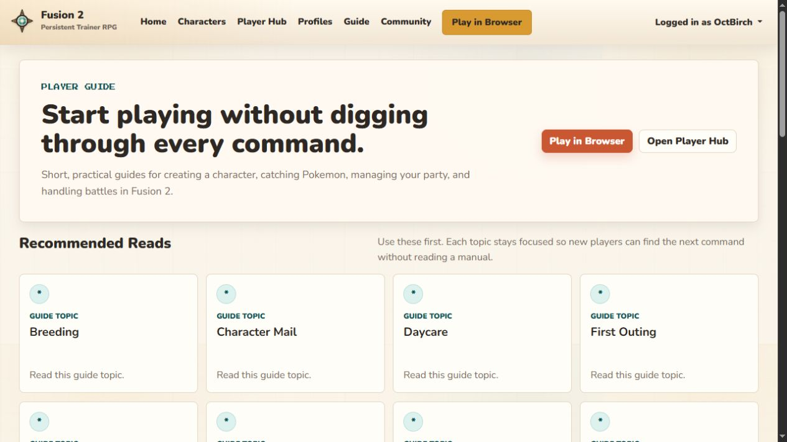
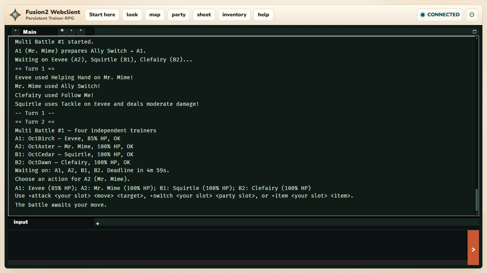

# October ordinary-player acceptance (#730–#733, #746)

October 24, 2026. **Final local acceptance passed.** This was a fresh real
Evennia server/portal, website and four independent ordinary WebSocket clients,
using a new random schema on the task-owned loopback PostgreSQL cluster.
No existing game service/database or human character was changed. Shared-server
deployment remains separate.

[Command/output diffs, prerequisites, observations and fingerprints](october-player-live-2026-10-24.json)
pin all 1,100 Python files to `5f398da333f8fc2c042e88cef13b543095bc07ff8d1448bc68c68510cd1b2bd0`,
based on `9f09deb`. The final server ran that copy from startup without hot reload.
Staged/committed Git-filtered blobs are checked against the tested candidate before
push. A later narration-only candidate has fingerprint
`f8fcd6c0ead886d6b726e557c90f01ec99250162a99dce26aad35c620f64b326`:
only the engine message flag and its existing regression case differ. A second
fresh four-account replay below verifies that exact final source. Historical
October 23 reports retain their original test/source evidence;
this dated record supersedes their pending live-acceptance status.
All final Python files subsequently match implementation commit
`e6373121f8fb8c2429498d97bd46be8978afaf82` under Git's newline filters.

## Ordinary actions and observed outcomes

| Area | Player route and observed result |
|---|---|
| Registration/onboarding | Four accounts register and log in through the website, select their own auto-created character and run `chargen`. Aster completes human Squirtle; Birch completes personal Fusion Eevee; Cedar/Dawn complete human Squirtle. All remain ordinary Player accounts. |
| Interrupted setup | Aster accepts initial choices, aborts, reloads the client, selects the character and resumes the saved draft. Completion issues exactly one initial Pokémon/receipt; later `chargen` refuses extra grants. |
| First activity | Players walk the authored QA exits. Aster enters the actual shop menu, buys one finite Potion and uses `+use Potion=1` to heal the separately damaged starter; the saved wallet reflects the purchase. All four start a battle through ordinary lobby consent. |
| Independent battle | A1/A2/B1/B2 each queues their own Tackle. An attempt to command a partner is refused. Aster queues an action, reloads/re-enters, retains the same controller, action and deadline, and cannot overwrite that action. Birch confirms whole-team concession; all four can walk away. |
| Team effects | In a second ordinary match, Aster uses Reflect, Dawn Follow Me, and the others Tackle. Saved status shows team A Reflect at four turns; Cedar still attacks the intended foe, Birch's opposing attack redirects to Dawn, and teammate abilities/items remain hidden from Birch. |
| Physical positions | Aster's self-targeted Ally Switch exchanges A1/A2. Aster subsequently controls A2 and Birch A1; a wrong actor label is refused. On the next turn Birch's Tackle reaches Cedar, proving Follow Me expired. |
| Ally/spread targets | Birch uses Helping Hand on Aster; Dawn uses Follow Me. Cedar's Surf still hits A1, A2 and its own teammate B2. Redirection affects only the eligible opposing single-target attack. |
| Reserves/faint | Aster switches its current A2 to its own canonical slot 6. Dawn's Clefairy later faints; the existing engine sends out Dawn's own reserve, preserving B2 and all four controllers. No teammate roster is borrowed. |
| Exhaustion/victory | A third ordinary match uses separately labelled strong/weak native fixture rosters. Cedar's sole battler faints; B1 stays empty and owes no input while Dawn continues. The next turn ends in normal team A victory. All four return to the Center. |
| Durable outcomes | Separate read-only staff observation confirms three claimed outcome receipts per controller, twelve total, correct team results, no EXP/TXP/money awards, and no remaining battle locks. |
| Mail and characters | Aster sends Birch mail #1, Birch reads/replies #2, Aster reads/marks unread/archives it. Cedar cannot read #1. Aster creates an alternate through the website, selects it normally, cannot read primary mail, sends #3 and receives #4; the primary cannot read #4. |
| Channels/read state | Public markers identify OctAsterAlt and OctAster as the actual session character. After Birch reconnects, its mailbox preserves read state and the already-read board has no unread post. |
| Board editor | `+bbpost October QA Board` accepts a free subject, opens the real empty line editor, saves the entered body with `:wq`, and reports Post saved without an inserted `look` or false abort. Birch reads the body; Cedar cannot delete it. |
| Profile privacy | Alternate marks Secret private and Greeting public. Owner web editor shows the private flag. A website edit to Greeting appears on Cedar's fresh game read; Secret never appears there. A foreign character selector shows unavailable with no edit forms. Anonymous Player Hub access redirects to login. |
| Sheets and custody | Game/web agree on wallet, gapped party slots 3/6, held Leftovers, boxed roster and labelled badge. Daycare deposit removes slot 6 and web shows reserved custody; receipt-backed retrieval returns it to slot 6. A reviewed gift transfers that same UUID to Birch; fresh hubs show the correct owners. Birch's personal Fusion remains separately reserved. |
| Read-only incomplete state | Staff removes only the empty disposable alternate's unused trainer/storage records. Game sheets/party and web hub show incomplete state. Read-only SQL observation confirms neither record nor Pokémon grants were recreated. |
| Guide examples | Actual counter advertises `+store`/Buy items; buying, held-item removal/re-equip, UUID box withdrawal/deposit, eligible `+teach 6=Water Gun`, move display, Daycare and reviewed trade work. `+pvp` discovers all formats; doubles rejects one conscious battler, accepts two, and both single/double requests can abort. Web beginner/gyms/storage/battle/PvP/Multi/Fusion topics and in-game beginner guidance are reachable. |

## Fixture boundaries, diagnosis and cleanup

Staff setup is recorded separately: finite shop stock and exits, wallet funds,
one damaged starter, native level-20/50/5 Pokémon with known move sets, a labelled
observation badge and one removed eligible learned move. These prerequisites do
not claim natural acquisition/progression. Actual `create_owned_pokemon` stat
helpers and canonical placement were used; ordinary players never received staff
permissions, debug battle launch, fabricated action outcomes or forced hit rolls.

Earlier diagnostic instances exposed the raw mail parser, board subject/context
and editor exit command, foreign profile forms, status privacy and Follow Me
scope/expiry gaps. Those were repaired and the affected automated suites rerun;
final acceptance uses the fresh pinned instance. Existing generic Reflect
feedback remains: saved effects and real recipients establish mechanics. The
new Ally Switch path initially reused the Trick Room change flag and announced
a false room change; final review corrected it and added an output regression.
A few UI locator waits expected a different success phrase; settled
output, rather than the wait result, establishes each outcome.

The minimal final world had no installed gym content, so `+gym list/check tempo`
correctly reported unavailable. Gym installation/challenges/rewards, limited-use
mechanics, concurrent inputs, hostile requests, private boards and injected
failure/recovery are separately covered by PostgreSQL checks; this report does
not call those additional live human walkthroughs. Web HP/PP/full Fusion stat
cards remain outside the existing web fields.

All four battle locks cleared and twelve durable outcomes were inspected before
shutdown. The owned supervisor stopped only its private ports 49965–49969 and
dropped its random schema; it exited successfully. Acceptance browser tabs were
closed, leaving the user's original GitHub tab alone. No shared deployment,
restart/migration of an existing game service, plot content or November scope is
claimed. The later app crash interrupted only the final automated test order;
the saved live evidence and completed cleanup survived.

## Final-source narration replay

A new source copy, new random schema and private ports 50065–50069 ran the final
`f8fcd6c0` candidate from startup. Four ordinary accounts registered and completed
human setup again. Staff installed the same native roster prerequisites; players
walked to the arena, independently joined/readied/launched and submitted Ally
Switch, Helping Hand, Tackle and Follow Me. The result said **Mr. Mime used Ally
Switch!**, retained Aster at A2/Birch at A1 and emitted **no Trick Room line**.
Players confirmed concession and all four walked back to the Center. The owned
supervisor stopped only this instance. A supplemental read-only staff helper
failed on its missing exec `__file__` before observations; it is not counted as
receipt proof. Earlier twelve SQL receipts cover the unchanged result code.
JSON keeps both source phases and the full final replay output.

The second app interruption also followed stale browser-tab cleanup, after this
replay finished. Remaining final gates were resumed without further browser
calls. No app/remote-server update or unrelated service change was performed.

After the final gates and app recovery, the exact task-cluster audit verifies both
live schemas absent and zero public tables. Only five inspected crash-orphan
test schemas are removed; unknown schemas or active clients stop cleanup. The
task-owned cluster is then stopped separately from all existing game services.

